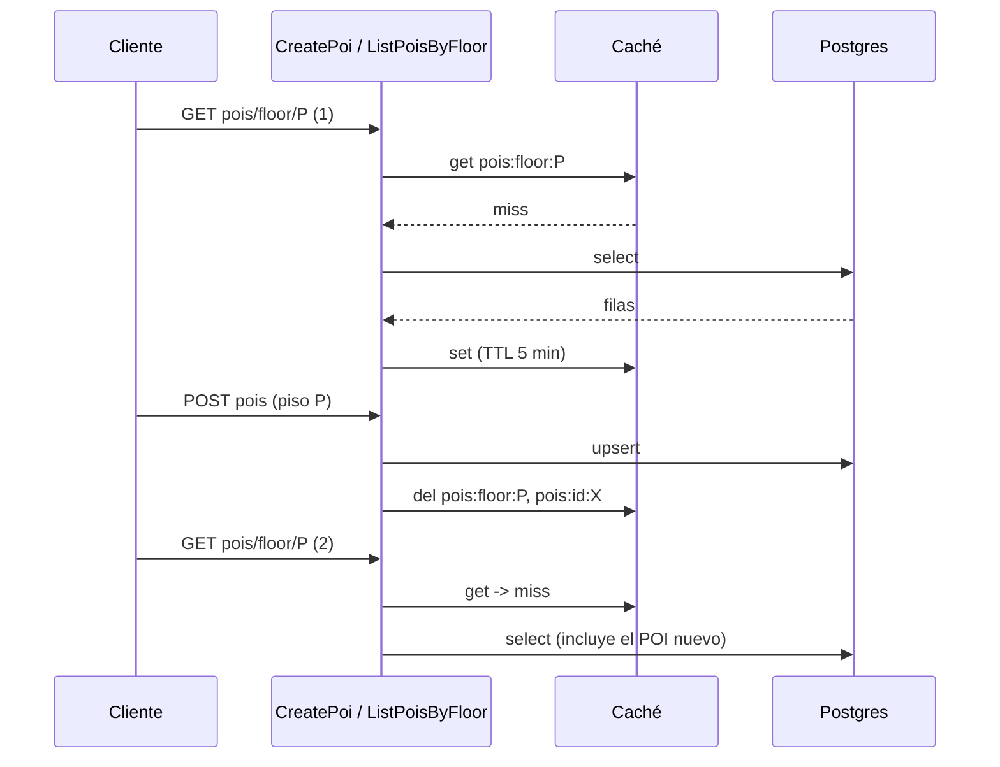

# Diseño de caché y política de invalidación

Implementación: `backend/src/shared/cache/` (servidor) y `frontend/lib/features/mapas/infrastructure/storage/model_cache.dart` (cliente). Garantías por operación: [consistencia-operaciones.md](consistencia-operaciones.md).

## Objetivo

Reducir latencia y carga sobre Supabase en las lecturas que sostienen EC-01 (primera vista < 5 s p95) y EC-04 (uso sin red), sin servir datos incorrectos de forma silenciosa.

## Niveles

| Nivel | Qué guarda | Tipo | Dónde |
|---|---|---|---|
| Cliente | Archivos `.glb` por `(edificio, versión)` | Local, persistente | Disco + índice Hive |
| Servidor | Edificios, pisos, POIs, URLs firmadas | **Local** (memoria del proceso) | `InMemoryTtlCache` tras el puerto `CachePort` |

Se eligió caché local y no distribuida porque el despliegue es **una instancia** (`render.yaml`, plan free): Redis añadiría un servicio, costo y un punto de falla sin beneficio hoy.

## Patrón de escritura/lectura

- **Lectura: cache-aside** (`getOrLoad`): se consulta la caché; si falla, se lee de la fuente y se guarda.
- **Escritura: invalidar, no actualizar.** `CreatePoi` borra las claves afectadas después del `upsert`. Se descartó *write-through* (hay que reconstruir en la escritura el mismo resultado que armaría la lectura, y dos escrituras concurrentes pueden dejar la caché en orden inverso) y *write-back* (una pérdida del proceso perdería escrituras confirmadas al cliente).

## Claves, TTL e invalidación

| Clave | Contenido | TTL | Invalidación |
|---|---|---|---|
| `mapas:buildings:all` | Lista de edificios | 10 min | Solo TTL |
| `mapas:building:{id}` | Edificio | 10 min | Solo TTL |
| `mapas:floors:{buildingId}` | Pisos del edificio | 10 min | Solo TTL |
| `mapas:floor:{floorId}` | Piso | 10 min | Solo TTL |
| `storage:signed:{buildingId}/{version}` | URL firmada del `.glb` | 50 min | Ninguna: la versión está en la clave |
| `pois:floor:{floorId}` | POIs de un piso | 5 min | **Explícita** en `CreatePoi` + TTL |
| `pois:id:{poiId}` | Un POI | 5 min | **Explícita** en `CreatePoi` + TTL |

### Tres mecanismos, cada uno donde corresponde

1. **TTL (acota la obsolescencia).** Los mapas se editan a mano en Supabase, sin pasar por la API, así que el backend no se entera: solo el tiempo puede expirar el dato. 10 min porque los edificios cambian rara vez; 5 min en POIs porque son el único dato que escribe la API.
2. **Invalidación explícita (read-your-writes).** `CreatePoi` borra `pois:floor:{pisoId}` y `pois:id:{id}` tras guardar. Así quien crea un POI lo ve en la lectura siguiente en vez de esperar el TTL.
3. **Clave versionada (sin invalidación).** El `.glb` y su URL firmada incluyen la versión: una versión nueva es una clave nueva, y la vieja caduca o se desaloja sola. Por eso las filas 4 y 12 de la tabla de consistencia no necesitan invalidación. Esto presupone modelos inmutables por versión (`uploadModel` usa `upsert: false`, fila 8).

### Reglas que protegen la corrección

- **No se cachean `null`, listas vacías por error ni excepciones.** Los repositorios ahora distinguen "no existe" (404) de "falló la BD" (503, `assertQueryOk`), de modo que un fallo transitorio no se vuelve "vacío" durante 10 min.
- **Desalojo:** LRU con tope de 500 entradas (memoria acotada en el plan free).
- **No se cachea** autenticación, roles ni ubicación: dependen de la identidad del solicitante o son sensibles.
- **Cliente:** al descargar la versión N con éxito se borran del disco e índice las versiones anteriores; si la descarga falla se conserva la anterior. `clearModelCache` y `clearAllCache` ya no son stubs.

## Observabilidad

| Métrica Prometheus (`/metrics`) | Etiquetas | Uso |
|---|---|---|
| `cache_requests_total` | `cache` (familia de clave: `mapas`, `pois`, `storage`), `result` (`hit`/`miss`) | Tasa de aciertos por familia |
| `cache_invalidations_total` | `reason` (`del`, `prefix`, `evict`, `expired`) | Ver cuánto se invalida y cuánto se desaloja por tope |

## Secuencia de `CreatePoi` y lectura posterior

## Cuándo pasar a Redis

Cambiar `InMemoryTtlCache` por una implementación Redis de `CachePort` (el puerto ya es asíncrono, sin tocar casos de uso) cuando ocurra **cualquiera** de estas:

- Se despliega **más de una instancia**: con caché local, cada instancia invalidaría solo lo suyo y el read-your-writes se perdería entre instancias.
- La tasa de aciertos medida con `cache_requests_total` es baja por reinicios frecuentes (el plan free duerme el servicio).
- Se necesita invalidar desde fuera de la API.

## Gancho futuro

Un webhook de base de datos o Supabase Realtime podría llamar a `delByPrefix('mapas:')` cuando alguien edite edificios o pisos en Supabase, reduciendo la dependencia del TTL. No se implementa ahora.

## Límites conocidos

- La caché local se pierde en cada reinicio (cold start del plan free).
- La caché devuelve la misma referencia de objeto a todos los llamadores: los casos de uso no deben mutar lo que reciben.
- No hay caché de metadatos en la app: EC-04 sigue sin cumplirse (ver fila 13 de la tabla de consistencia).
