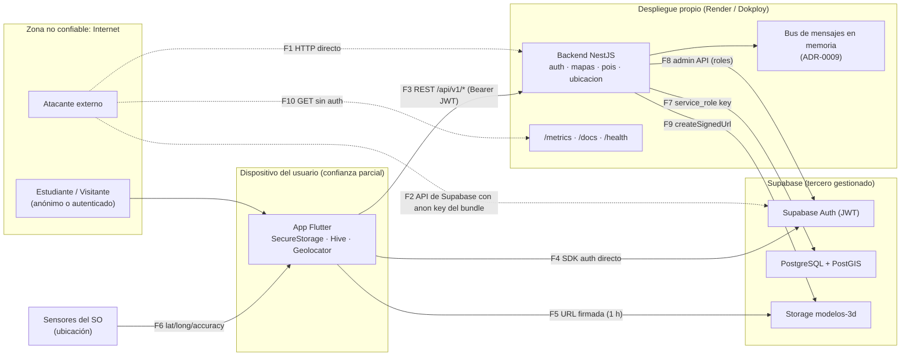

# S11 — Modelo del sistema para el análisis de amenazas (DFD)

> Fuente: `docs/c4/C4_L2_Container.md`, `backend/src/main.ts`, `deploy/compose.lab.yaml`, `render.yaml`.
> Complementa: [`amenazas.md`](./amenazas.md).

## 1. Diagrama de flujo de datos con límites de confianza

## 2. Activos

| ID | Activo | Dónde vive | Sensibilidad |
|----|--------|-----------|--------------|
| AS-1 | Credenciales y tokens de sesión (access/refresh) | Supabase Auth, `SecureStorage` del dispositivo | Alta |
| AS-2 | Rol del usuario (`estudiante` … `admin_utb`) | `user_metadata` de Supabase | Alta (decide privilegios) |
| AS-3 | `SUPABASE_SERVICE_ROLE_KEY` | Variables de entorno de Render/Dokploy (`client.ts:11`) | Crítica (omite RLS) |
| AS-4 | Catálogo de edificios, pisos y POIs | PostgreSQL/PostGIS | Media (integridad más que confidencialidad) |
| AS-5 | Modelos 3D `.glb` | Supabase Storage | Baja |
| AS-6 | Ubicación del usuario | Dispositivo (`location_service_impl.dart`) | Alta (dato personal) |
| AS-7 | Correo y nombre del usuario | Supabase Auth | Media (dato personal) |
| AS-8 | Disponibilidad de la API | Instancia de 256 MB / 0,5 CPU (`compose.lab.yaml:32-35`) | Media |

## 3. Actores y motivación

| Actor | Capacidad | Qué ganaría |
|-------|-----------|-------------|
| Atacante anónimo en Internet | Conoce la URL; `/docs` publica todos los endpoints | Escalar a administrador, alterar el mapa, tumbar el servicio |
| Usuario registrado malicioso | Tiene un JWT válido y la anon key (va en el bundle) | Elevar su propio rol, ver o alterar datos ajenos |
| Insider (integrante del equipo) | Acceso a CI, paneles y secretos | Filtración accidental o intencional de la service key |
| Proveedor / dependencia comprometida | Código que se ejecuta en build y runtime | Robo de secretos, puerta trasera |
| Asistente de IA usado en desarrollo | Lee el repo y propone código (`docs/ia.md`) | (No es adversario; es un vector: inyección de instrucciones, paquetes inventados) |

## 4. Superficie de ataque verificada en el código

| Endpoint / punto | Autenticación en código | Evidencia |
|------------------|-------------------------|-----------|
| `POST /api/v1/auth/users/:userId/role` | **Ninguna** (la doc dice "solo admin") | `auth.controller.ts:87-94` |
| `POST /api/v1/pois` | **Ninguna** (la doc dice "admin") | `pois.controller.ts:43-49` |
| `POST /api/v1/location/manual` | Ninguna | `ubicacion.controller.ts:26-31` |
| `GET /api/v1/auth/me` | Lee el header a mano | `auth.controller.ts:78-85` |
| `GET /metrics`, `GET /docs` | Ninguna, públicos en producción | `main.ts:35-36, 43` |
| Resto de `GET /api/v1/map/*`, `/pois/*` | Públicos por diseño (mapa para visitantes) | `mapas.controller.ts`, `pois.controller.ts` |

Búsqueda realizada: no existe `UseGuards`, `helmet` ni `ThrottlerModule` en `backend/src` ni en `backend/package.json`.
